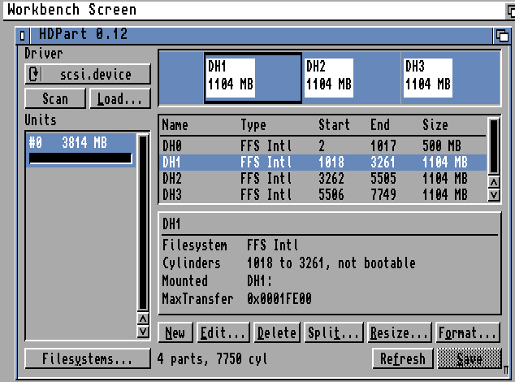
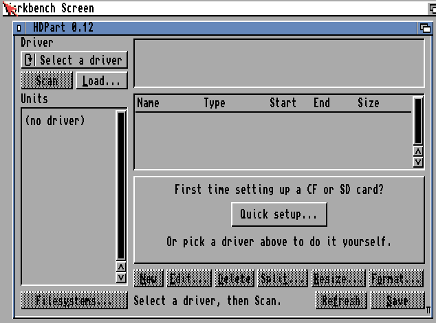
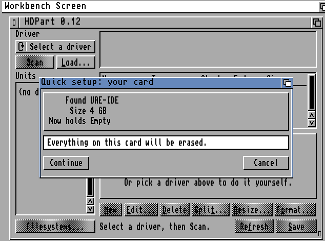
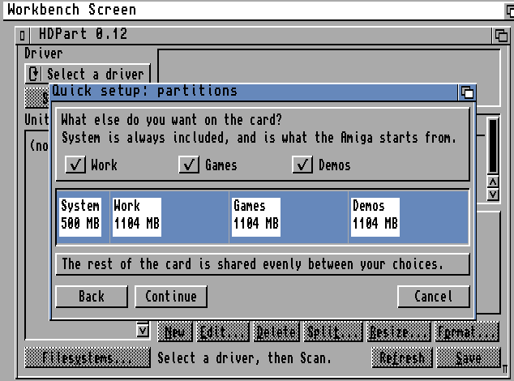
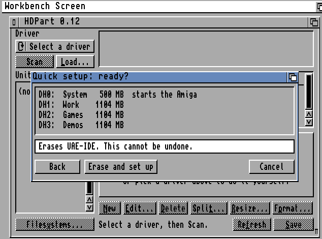
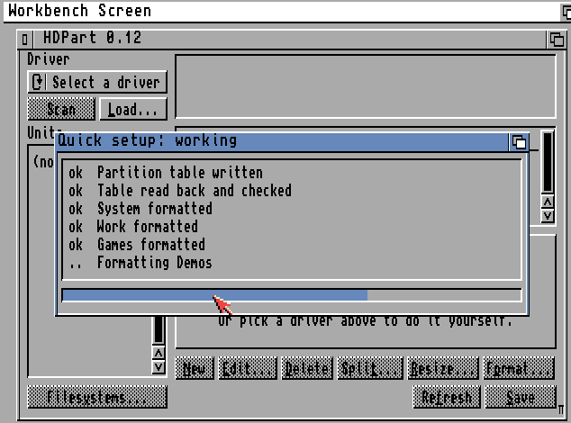
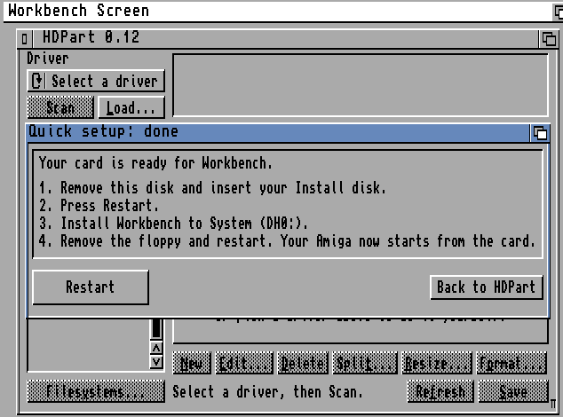

# HDPart

A modern AmigaOS **RDB hard-disk partition tool** for Kickstart 2.04+ (V37+) — a
usable HDToolBox replacement aimed at CF/SD-on-IDE retro setups. GadTools GUI,
single window, runs on a real Workbench or boots standalone from its own floppy.

- **Quick setup:** a guided path for first-timers that gets a CF or SD card ready
  for a Workbench install. See [below](#quick-setup).
- Pick a driver → scan its units → read the Rigid Disk Block → init / partition /
  resize / split → save.
- **Format** a partition into a ready, empty volume live — no reboot. Won't format
  the disk you booted from.
- **Filesystems:** the ROM ones (FFS/OFS, Intl, DirCache), plus PFS3 and SFS
  handlers embedded in the RDB, loaded from a file or copied from another disk.
- **Guided settings:** presets and help for MaxTransfer, Mask, Buffers and Buffer
  memory, based on what the Kickstart ROMs and PFS3 actually do with them.
- **Drive Bay GUI:** a map of the disk across the top, the partition table and a
  details panel below it, a screen-top Amiga menu bar and keyboard shortcuts. It
  opens on the Workbench screen.
- File pickers use `asl.library` when it's there, which the boot floppy doesn't
  include, and a typed path otherwise. *Load asl.library...* can bring one in from
  another disk.
- Freestanding 68000 build — runs on a stock A500+/A600/A1200/A4000.



## Quick setup

Quick setup is for someone with a new CF or SD card who just wants it ready for
Workbench, without learning what cylinders are. It asks what you want on the
card, shows you the result, erases the card, and makes a System partition and
your choice of Work, Games and Demos, formatted and ready.

| | |
|:---:|:---:|
|  |  |
| Click **Quick setup...** in the main window | It shows the card and warns before erasing |
|  |  |
| Tick what you want, and the map follows | One last look before anything is erased |
|  |  |
| Each step is ticked off as it runs | Then it tells you what to do next |

*Shown in an emulator with a 4 GB card, which is why it's called UAE-IDE.*

**It is for** an A600, A1200 or A4000 with a CF or SD card on the internal IDE
port, started from the HDPart floppy.

**It is not for** an A500, an A3000, SCSI drives, PCMCIA cards or Zorro
controllers, or for anything that needs PFS3 or larger partitions. It uses at
most the first 4 GB of a card and makes partitions of at most 2 GB. For anything
else, use HDPart's main window. On a machine or setup it can't confirm, it says
so and changes nothing.

**How far it has been tested:** in an emulator only. It has not yet been run on
real hardware, or with a real Workbench install. Keep a copy of anything you
care about on the card.

## Credits & attribution

HDPart's RDB handling is **based on `rdbtool`** (part of **amitools**) by
**Christian Vogelgsang, © 2020–2023**. The engine's on-disk RDB layout follows
rdbtool, and the host test suite cross-checks HDPart's output **byte-for-byte
against `rdbtool`** (`tests/verify-rdbtool.sh`). With thanks.

- Docs: https://amitools.readthedocs.io/en/latest/tools/rdbtool.html
- Source: https://github.com/cnvogelg/amitools

Built entirely with **Bartman's `vscode-amiga-debug`** C/C++ toolchain &
extension (m68k-amiga-elf GCC, `elf2hunk`, and the Amiga SDK) — thank you.

- Source: https://github.com/BartmanAbyss/vscode-amiga-debug

## Building

Uses the Bartman `amiga-debug` GCC cross-toolchain (m68k-amiga-elf, gcc 15.x),
which is **not** on the default PATH:

```sh
export AMIGA_BIN="$HOME/.vscode/extensions/bartmanabyss.amiga-debug-1.8.2/bin/darwin"  # or .../linux
export PATH="$AMIGA_BIN/opt/bin:$AMIGA_BIN:$PATH"

make            # -> out/HDPart.exe (AmigaDOS hunk) + out/HDPart.elf (symbols)
make adf        # -> out/HDPart-<ver>.adf  (bootable 880K OFS floppy; needs amitools' xdftool)
```

Host-side RDB engine tests (system `cc`, no toolchain needed):

```sh
./tests/run-host-tests.sh       # unit tests for the RDB engine
./tests/verify-rdbtool.sh       # byte-for-byte cross-check vs amitools rdbtool
```

On-target suite, which drives the real GUI in WinUAE on Kickstart 2.04, 3.1 and
3.2 (needs your own ROMs and a filesystem handler; see
[`tests/target/README.md`](tests/target/README.md)):

```sh
make target-test    # the normal UI, on those three Kickstarts
make target-quick   # Quick setup, on emulated IDE, for every machine whose ROM you set
```

## License

HDPart's own source is released under the **MIT License** — see [`LICENSE`](LICENSE).

amitools / rdbtool are © Christian Vogelgsang and the Bartman toolchain is © its
authors, each under their own license; **HDPart bundles no amitools, Bartman,
Commodore, or Amiga files** (the toolchain, Kickstart ROM, and Workbench fonts are
all external to this repo).

